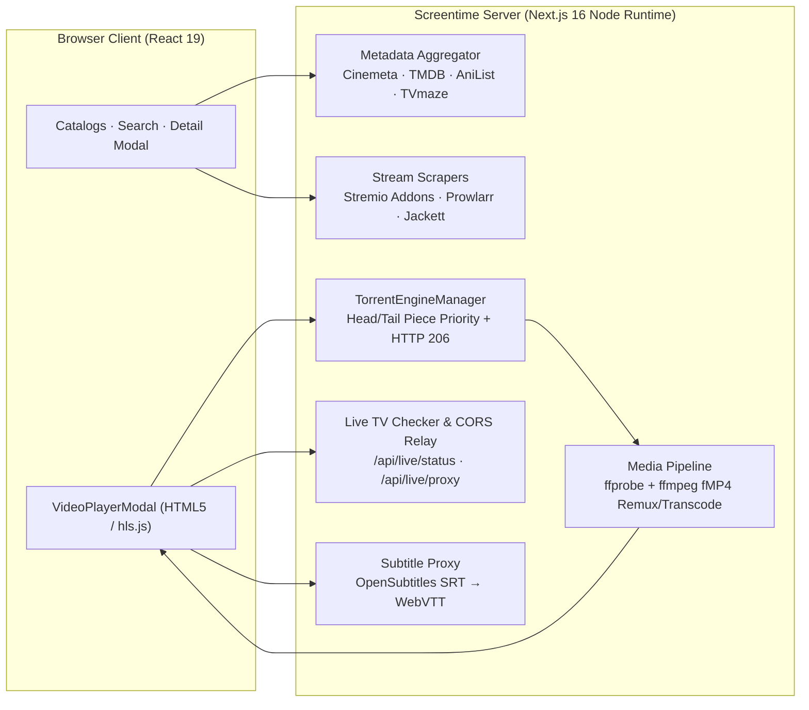

# Screentime

[](https://github.com/jvanheerikhuize/screentime/actions/workflows/ci.yml)
[](https://github.com/jvanheerikhuize/screentime/actions/workflows/docker.yml)
[](LICENSE)
[](package.json)

**A zero-config, self-hosted streaming dashboard for your home network.**

Browse movies, TV series, and anime from free, keyless catalogs, watch 1,700+ free-to-air live TV channels, and stream torrents directly in your browser — with MKV, HEVC/x265, AC3, EAC3, and DTS converted on the fly via `ffmpeg`.

No accounts, cloud logins, or mandatory API keys required.

---

## Highlights

- **Movies & Series** from [Cinemeta](https://v3-cinemeta.strem.io) with genre/year filters, IMDb ratings, and full season/episode guides. Optional [TMDB](https://www.themoviedb.org/) integration when `TMDB_API_KEY` is provided.
- **Anime** from [AniList](https://anilist.co) (trending, seasonal, popular, and top-rated), automatically cross-referenced via [Fribb/anime-lists](https://github.com/Fribb/anime-lists) to Kitsu and IMDb IDs for episode streams and subtitles.
- **What's On Today:** "New episodes today" row and live series status (*"Returning series · Next: S2 · E5"*) powered by [TVmaze](https://www.tvmaze.com).
- **Live TV:** ~1,700 free-to-air channels from [Free-TV/IPTV](https://github.com/Free-TV/IPTV) plus curated international news/sports feeds, with country/search filters, background batch on-air verification (with an offline toggle), and a built-in CORS HLS relay (`/api/live/proxy`).
- **Smart Torrent Streaming:**
  - Queries Stremio addons ([Torrentio](https://torrentio.strem.fun) and MediaFusion by default; add custom manifests in Settings) plus optional self-hosted **Prowlarr** and **Jackett** indexers.
  - Prioritizes first and last pieces (`moov` atom) for fast startup, ranks sources by browser streamability, and automatically fails over if a swarm stalls.
  - Announces to a daily-refreshed list of live [public trackers](https://github.com/ngosang/trackerslist).
- **Plays Almost Anything in Any Browser:** `ffprobe` inspects every stream before playback; H.264/AAC MP4/WebM streams play directly (`206 Partial Content`), while MKV/AVI containers are remuxed (`-c:v copy`) and HEVC/AV1/AC3/DTS streams are transcoded on the fly to fragmented MP4 (`fMP4`) with full seek support.
- **Automatic Subtitles:** Fetches subtitles in your preferred language from OpenSubtitles, converts SRT to WebVTT on the fly, and keeps cues synchronized across transcoded seeks.

---

## How Screentime Compares

| Capability | Screentime | Stremio Web | Jellyfin + \*arr Stack |
| :--- | :--- | :--- | :--- |
| **Zero-Account / No Cloud Login** | Yes | Requires Stremio account sync | Yes |
| **Built-in Torrent Engine + `ffmpeg` Remux/Transcode** | Built-in (`node` + `ffmpeg`) | Needs external local companion service | Requires separate qBittorrent + Radarr/Sonarr |
| **Stremio Addon + Prowlarr/Jackett Support** | Both built-in | Stremio Addons only | Prowlarr/Jackett via \*arr |
| **1,700+ Free-to-Air Live TV + CORS Relay** | Built-in | Via third-party addons | Requires M3U tuner setup |
| **Setup Time** | **1 command (`docker compose up -d`)** | Cloud web app + local server | Multi-container stack |

---

## Quick Start (Docker — Recommended)

Run Screentime with `ffmpeg` pre-installed in a single container:

```bash
docker compose up -d
```

Or with `docker run`:

```bash
docker run -d \
  --name screentime \
  -p 3000:3000 \
  --restart unless-stopped \
  ghcr.io/jvanheerikhuize/screentime:latest
```

Then open **http://localhost:3000** (or `http://<your-lan-ip>:3000` from any TV, tablet, or phone on your home network).

---

## Local Installation (Node.js)

### Requirements
- **Node.js 22.18+**
- **`ffmpeg` and `ffprobe`** on your `PATH`:
  - Debian / Ubuntu: `sudo apt install ffmpeg`
  - macOS: `brew install ffmpeg`

```bash
git clone https://github.com/jvanheerikhuize/screentime.git
cd screentime
npm install
npm run build
npm start            # or: npm run dev for development with hot reload
```

---

## Architecture



---

## Configuration

Everything works out of the box with zero configuration. Optional environment variables can be placed in `.env.local` (or passed to Docker via `compose.yaml`; see [`.env.example`](.env.example)):

| Variable | Description |
| :--- | :--- |
| `TMDB_API_KEY` | Optional [TMDB API key](https://www.themoviedb.org/settings/api) for TMDB trending lists and metadata. |
| `PROWLARR_URL`, `PROWLARR_API_KEY` | Query your self-hosted Prowlarr instance for every movie and series. |
| `JACKETT_URL`, `JACKETT_API_KEY` | Query your self-hosted Jackett Torznab endpoint for every movie and series. |
| `SCREENTIME_ALLOW_PRIVATE_ADDONS` | Set to `1` to allow Stremio addons hosted on private RFC1918 LAN addresses. |
| `SCREENTIME_INTERNAL_PORT` | Internal HTTP port Next.js listens on when behind a reverse proxy on `80`/`443` (defaults to `PORT` or `3000`). |

Inside the web UI, click **Settings** (top-right sliders icon) to:
- View active catalog, tracker, and subtitle integrations
- Add or remove custom **Stremio addon** `manifest.json` URLs
- Configure and test **Prowlarr** or **Jackett** connections per browser
- Set your default **subtitle language**

---

## Player Keyboard Shortcuts

| Key | Action |
| :--- | :--- |
| `Space` / `K` | Play / Pause |
| `←` / `→` | Seek backward / forward 10 seconds |
| `F` | Toggle fullscreen |
| `M` | Toggle mute |
| `C` | Toggle subtitles on / off |
| `Esc` | Close menus or exit player |

---

## Development

```bash
npm run dev         # Start Next.js dev server with hot reload
npm run lint        # Run ESLint
npm run typecheck   # Run TypeScript compiler checks (tsc --noEmit)
npm test            # Run unit test suite (Node built-in test runner)
npm run build       # Build standalone production bundle
```

### Project Layout

```text
src/app/            Next.js App Router pages & API routes (/api/media, /api/stream, /api/playback, /api/live, /api/health)
src/components/     React UI components (Navbar, HeroBanner, MediaCarousel, MediaDetailModal, VideoPlayerModal, LiveChannelsGrid)
src/lib/metadata/   Cinemeta, TMDB, AniList, Fribb anime-lists, and TVmaze clients + TTL cache
src/lib/scrapers/   Stremio addon client and Prowlarr/Jackett Torznab aggregator
src/lib/streaming/  BitTorrent swarm manager, tracker refresher, source scoring, ffprobe & ffmpeg pipeline
src/lib/channels/   Curated and Free-TV/IPTV M3U8 parser
src/lib/net/        SSRF host classifier, DNS-verifying guardedFetch, and bounded response reader
tests/              Unit test suite
```

Contributions are welcome! Please read [CONTRIBUTING.md](CONTRIBUTING.md) and our [Code of Conduct](CODE_OF_CONDUCT.md).

---

## Security

Screentime is designed for a trusted home network (or private VPN/Tailscale mesh). It does not include user authentication, so do not expose it directly to the public internet without an authenticating reverse proxy. All upstream fetches validate DNS and redirect hops against SSRF into link-local or private networks. See [SECURITY.md](SECURITY.md) for details.

## Disclaimer

Screentime does not host, store, or distribute any media content. It aggregates metadata and stream links from public catalogs, user-configured addons/indexers, and public BitTorrent swarms. You are solely responsible for complying with applicable laws in your jurisdiction.

## License

Released under the [MIT License](LICENSE).
